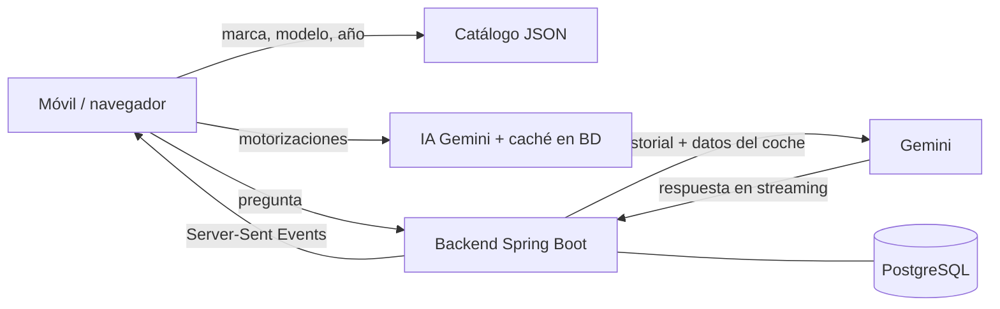

# MecanicAI · Tu mecánico con IA

SaaS web (pensado para el móvil) en el que el usuario elige su coche —**marca → modelo → año → motorización**— y
después pregunta lo que necesite a un mecánico de inteligencia artificial que responde teniendo en cuenta ese coche
concreto.

| Elige la marca | Motorización | Chat con la IA | Historial y garaje |
| :---: | :---: | :---: | :---: |
|  |  |  |  |

## Funcionalidades

- **Asistente del coche** en 4 pasos con buscador. Catálogo de ~57 marcas y ~900 modelos del mercado español con sus
  años de venta. Las **motorizaciones las sugiere la IA** para ese modelo y año y se guardan en caché (cada combinación
  se consulta una sola vez). Si el coche no está, se puede escribir a mano o elegir "no sé el motor".
- **Chat con IA en tiempo real** (streaming, como ChatGPT/Gemini): respuestas en Markdown, botón de detener, reintentar
  si falla, copiar la respuesta y sugerencias rápidas. El "mecánico" conoce el coche, avisa de los riesgos de seguridad y
  dice cuándo ir al taller.
- **Portada** con dos opciones: **Iniciar con Google** o **Modo Invitado** (pocos mensajes al día y nada guardado en
  el servidor). Al iniciar sesión, la consulta del invitado y su coche se guardan automáticamente en la cuenta.
- **Historial de consultas y garaje** (varios coches por usuario), borrar consultas/coches y **eliminar la cuenta** (RGPD).
- **Límites diarios**: invitado 5 mensajes/día, cuenta gratuita 20/día (configurable). Plan **PRO** preparado para
  el futuro (más mensajes y otro modelo de IA).
- **Dictado por voz** (botón de micrófono, Web Speech API del navegador, sin coste).
- **Instalable como app** (PWA): pantalla completa y vertical, icono propio.
- Diseño mecánico: grafito y acero cepillado, llanta como logotipo e indicador de carga, tapacubos por marca, pasos
  en forma de tuerca y franja de dibujo de neumático.

## Tecnologías

| Parte | Tecnología |
| --- | --- |
| Frontend | React 19 + TypeScript + Vite 8, React Router 8, react-markdown, vite-plugin-pwa |
| Backend | Java 25 + Spring Boot 4.1 + Maven (Spring Security OAuth2, Spring Data JPA, Flyway, validación) |
| Base de datos | PostgreSQL 17 |
| IA | Google Gemini con el SDK oficial `com.google.genai` (detrás de una interfaz `AiClient` para poder cambiar de proveedor) |

```
MecanicAI/
├── backend/            API REST (Spring Boot)
│   └── src/main/
│       ├── java/com/mecanicai/   auth, user, vehicle, catalog, chat, ai, usage, config
│       └── resources/            application.yml, catalog/vehicles.json, db/migration (Flyway)
├── frontend/           Web (React + Vite)
│   └── src/            api, components, context, features (wizard, chat), pages, styles
├── compose.yaml        Despliegue con contenedores (PostgreSQL + backend + nginx)
└── docs/capturas/
```

## Puesta en marcha en local

El orden siempre es el mismo: **1) base de datos → 2) backend → 3) frontend**. El backend necesita la base de datos
para arrancar (crea las tablas al iniciar) y la web necesita el backend para funcionar.

### 1. Requisitos

- **JDK 25** (Fedora solo trae el JRE; para compilar hace falta el JDK):
  ```bash
  sudo dnf install java-25-openjdk-devel
  ```
- **Node.js 22+** y **podman** (ya los tienes).

### 2. Base de datos (primero)

```bash
podman run -d --name mecanicai-db -p 5432:5432 \
  -e POSTGRES_DB=mecanicai -e POSTGRES_USER=mecanicai -e POSTGRES_PASSWORD=mecanicai \
  -v mecanicai-data:/var/lib/postgresql/data docker.io/library/postgres:17-alpine
```

Las siguientes veces basta con `podman start mecanicai-db`. Las tablas las crea Flyway al arrancar el backend.

### 3. Backend (segundo)

```bash
cd backend
cp .env.example .env        # y pon tu GEMINI_API_KEY (ver más abajo)
./mvnw spring-boot:run -Dspring-boot.run.profiles=dev
```

Sin `GEMINI_API_KEY`, el perfil `dev` arranca la IA en **modo demo** (respuestas de ejemplo) para poder trabajar en la
interfaz sin clave. Sin credenciales de Google, la portada solo ofrece el **Modo Invitado**.

### 4. Frontend (tercero)

```bash
cd frontend
npm install
npm run dev
```

Abre <http://localhost:5173>. Vite reenvía `/api`, `/oauth2` y `/login/oauth2` al backend (puerto 8080), así el
navegador ve un único dominio y las cookies de sesión funcionan.

**Probar en tu móvil** (misma wifi): `npm run dev -- --host` y abre `http://IP-DE-TU-PC:5173`. El micrófono y la
instalación como app requieren HTTPS fuera de `localhost`, así que para probarlos en el móvil hay que desplegarla con
HTTPS.

## Conseguir la API key de Gemini (gratis)

1. Entra en <https://aistudio.google.com/apikey> con tu cuenta de Google y pulsa **Create API key**.
2. Ponla en `backend/.env` como `GEMINI_API_KEY=...` y reinicia el backend.

Modelos por defecto, **en orden de preferencia**: si uno está saturado (algo habitual en la capa gratuita), la app
prueba automáticamente el siguiente. Se cambian con variables de entorno (ver `application.yml`):

| Uso | Modelos | Variable |
| --- | --- | --- |
| Chat plan gratuito | `gemini-3.6-flash`, `gemini-3.7-flash`, `gemini-3.8-flash`, `gemini-3.5-flash`, `gemini-3.1-flash-lite` | `GEMINI_CHAT_MODELS` |
| Sugerir motorizaciones | los mismos | `GEMINI_ENGINES_MODELS` |
| Plan PRO (futuro) | `gemini-3.8-flash`, `gemini-3.7-flash`, `gemini-3.6-flash` | `GEMINI_PRO_MODELS` |

**A tener en cuenta con la capa gratuita de Gemini:**

- Los límites (peticiones por minuto y por día) son **por proyecto de Google, compartidos por todos tus usuarios**.
  Consulta los tuyos en <https://aistudio.google.com/rate-limit>. Si se superan, la app muestra "La IA está saturada,
  inténtalo en unos segundos" y no descuenta el mensaje al usuario. Si se te queda corto, activa la facturación del
  proyecto (los modelos Flash cuestan céntimos por conversación).
- La disponibilidad de cada modelo en la capa gratuita cambia a lo largo del día: en las pruebas, `gemini-3.6-flash`
  respondía en 2-6 s mientras otros daban error 503 ("high demand") y `gemini-3.5-flash-lite` tardaba más de 25 s.
  Por eso la app usa una lista de modelos y salta al siguiente cuando uno está saturado.
- En la capa gratuita **Google puede usar el contenido de las consultas para mejorar sus productos** (en la de pago no).
  Indícalo en tu política de privacidad antes de abrir la app al público.

## Configurar el login con Google

1. En <https://console.cloud.google.com> crea un proyecto (o usa el de Gemini).
2. **APIs y servicios → Pantalla de consentimiento de OAuth**: tipo *Externo*, nombre "MecanicAI", tu correo de
   soporte y los ámbitos `email`, `profile` y `openid`.
3. **Credenciales → Crear credenciales → ID de cliente de OAuth → Aplicación web**:
   - Orígenes de JavaScript autorizados: `http://localhost:5173` (y en producción `https://tu-dominio.com`).
   - URI de redirección autorizados: `http://localhost:5173/login/oauth2/code/google`
     (y en producción `https://tu-dominio.com/login/oauth2/code/google`).
4. Copia el ID y el secreto en `backend/.env` (`GOOGLE_CLIENT_ID`, `GOOGLE_CLIENT_SECRET`) y reinicia el backend: el
   botón "Continuar con Google" aparece solo.
5. Antes de abrirla al público, en la pantalla de consentimiento pulsa **Publicar aplicación**: mientras esté en modo
   "Prueba", solo pueden entrar las cuentas que añadas como usuarios de prueba.

## Cómo funciona



- **Sesión**: tras el login de Google, el backend crea una cookie `HttpOnly` con un JWT propio (30 días, se renueva
  sola). Protección CSRF: cookie `SameSite=Lax` + cabecera obligatoria `X-MecanicAI` en las peticiones que modifican
  datos.
- **Invitados**: la consulta se guarda solo en el navegador (localStorage). El límite va por cookie anónima (5 al día)
  y por IP (20 al día entre todos los invitados de una misma conexión): otro navegador o una ventana de incógnito es
  un invitado nuevo, pero desde la misma conexión no pasa de 20.
- **Límites**: contador diario atómico en PostgreSQL (`usage_counter`). Si la IA falla, el mensaje no se descuenta.
- **Prompt del mecánico**: `backend/src/main/java/com/mecanicai/chat/PromptBuilder.java`.
- **Catálogo**: `backend/src/main/resources/catalog/vehicles.json` (formato `"Modelo": "1991-2004,2024-"`); se puede
  ampliar sin tocar código.

### API

| Método | Ruta | Descripción |
| --- | --- | --- |
| GET | `/api/auth/me` | Usuario (o invitado), uso de hoy y opciones disponibles |
| POST | `/api/auth/logout` · DELETE `/api/auth/account` | Cerrar sesión · borrar cuenta y datos |
| GET | `/api/catalog/brands` · `/api/catalog/brands/{marca}/models` | Catálogo |
| GET | `/api/catalog/engines?brand=&model=&year=` | Motorizaciones sugeridas por la IA |
| GET/POST/DELETE | `/api/vehicles` | Garaje del usuario |
| GET/POST/DELETE | `/api/conversations` | Historial de consultas |
| POST | `/api/conversations/{id}/messages` · `/retry` | Pregunta / reintento (respuesta en streaming SSE) |
| POST | `/api/conversations/import` | Guarda en la cuenta la consulta hecha como invitado |
| POST | `/api/guest/chat` | Chat de invitado (streaming SSE) |

## Tests

```bash
cd backend && ./mvnw test          # catálogo, prompt, respuestas de la IA, cambio de modelo, seguridad
cd frontend && npm run lint && npm run build
```

## Despliegue en internet, paso a paso

```
Usuario ──HTTPS──▶ Caddy ──▶ nginx (web + /api) ──▶ backend Spring Boot ──▶ PostgreSQL
                  (certificado                              └──────────────▶ Gemini
                   automático)
```

Todo va en contenedores definidos en `compose.yaml`, y compose se encarga del orden de arranque.

### Qué necesitas

- **Un servidor Linux** con IP pública y al menos 2 GB de RAM (mejor 4 GB: Java, PostgreSQL y la compilación de las
  imágenes). Por ejemplo, un VPS de Hetzner, OVH, DigitalOcean o Contabo (unos 4-6 €/mes) o, gratis, una máquina de la
  capa *Always Free* de Oracle Cloud.
- **Un dominio** (unos 10 €/año). Google solo permite el login en producción con un dominio real y HTTPS.
- Tu **API key de Gemini** y, para el login, las credenciales OAuth de Google.

### Paso 1 · Preparar el servidor

Crea el servidor con Ubuntu 24.04 y abre los puertos 22, 80 y 443 en el firewall del proveedor. Después:

```bash
ssh root@IP-DEL-SERVIDOR
curl -fsSL https://get.docker.com | sh      # instala Docker y Docker Compose
```

### Paso 2 · Apuntar el dominio al servidor

En el panel de tu dominio crea un registro DNS **tipo A**: `mecanicai.tudominio.com` → IP del servidor. Comprueba con
`ping mecanicai.tudominio.com` que ya apunta ahí **antes del paso 5**: Caddy lo necesita para conseguir el
certificado HTTPS.

### Paso 3 · Subir el código

Lo más cómodo es un repositorio privado de GitHub (el `.gitignore` ya excluye los `.env` con las claves):

```bash
git clone https://github.com/TU-USUARIO/mecanicai.git /opt/mecanicai && cd /opt/mecanicai
```

O cópialo desde tu PC:
`rsync -av --exclude node_modules --exclude target --exclude .env MecanicAI/ root@IP-DEL-SERVIDOR:/opt/mecanicai/`

### Paso 4 · Configurar las claves

```bash
cp .env.example .env
nano .env
```

Rellena `DOMAIN` (sin `https://`), `GEMINI_API_KEY`, `JWT_SECRET` (`openssl rand -base64 48`), `DB_PASSWORD`
(`openssl rand -base64 24`) y, para el login, `GOOGLE_CLIENT_ID` y `GOOGLE_CLIENT_SECRET`.

### Paso 5 · Arrancar

```bash
docker compose up -d --build
```

La primera vez tarda unos minutos (compila el backend y el frontend). Compose arranca los servicios en este orden:

1. **db**: PostgreSQL; espera a que esté lista para aceptar conexiones.
2. **backend**: Spring Boot; al arrancar crea o actualiza las tablas automáticamente (Flyway).
3. **frontend**: nginx con la web; reenvía `/api` al backend.
4. **caddy**: consigue el certificado HTTPS y publica la web en los puertos 80 y 443.

### Paso 6 · Comprobar

```bash
docker compose ps                 # los 4 servicios en marcha ("Up")
docker compose logs -f backend    # debe aparecer "Started MecanicAiApplication"
docker compose logs caddy         # debe aparecer "certificate obtained successfully"
```

Abre `https://mecanicai.tudominio.com` en el móvil, elige un coche y haz una pregunta.

### Paso 7 · Login con Google en producción

En la consola de Google (ver [Configurar el login con Google](#configurar-el-login-con-google)) añade el origen
`https://mecanicai.tudominio.com` y la redirección `https://mecanicai.tudominio.com/login/oauth2/code/google`.

### Mantenimiento

| Tarea | Comando |
| --- | --- |
| Actualizar tras cambiar el código | `git pull && docker compose up -d --build` |
| Ver errores | `docker compose logs -f backend` |
| Copia de seguridad de la BD | `docker compose exec db pg_dump -U mecanicai mecanicai > copia-$(date +%F).sql` |
| Restaurar una copia | `docker compose exec -T db psql -U mecanicai mecanicai < copia.sql` |
| Parar todo (los datos se conservan) | `docker compose down` (con `down -v` se **borrarían** los datos) |

**¿Podman en lugar de Docker?** Funciona igual con `podman-compose` (probado con la versión 1.6). Hay dos diferencias:
para usar los puertos 80 y 443 sin ser root ejecuta `sudo sysctl net.ipv4.ip_unprivileged_port_start=80`, y al
actualizar usa `podman-compose up -d --build --force-recreate`, porque podman-compose no recrea solo los contenedores
que cambian.

## Próximos pasos (hoja de ruta)

- **Suscripción PRO con Stripe**: el modelo de datos ya tiene `plan` (FREE/PRO) y cada plan su modelo y su límite en
  `app.plans`. Hoy se puede probar a mano: `UPDATE app_user SET plan = 'PRO' WHERE email = '...';`
- **IA más potente para PRO (p. ej. GPT)**: implementar `AiClient` con el SDK de OpenAI y elegir el proveedor según el
  plan; el resto de la app no cambia.
- La API `generateContent` de Gemini que se usa está soportada pero Google recomienda su nueva *Interactions API* para
  proyectos nuevos; migrar solo afecta a `GeminiAiClient`.
- Fotos en el chat (testigos del cuadro, piezas): Gemini ya entiende imágenes.
