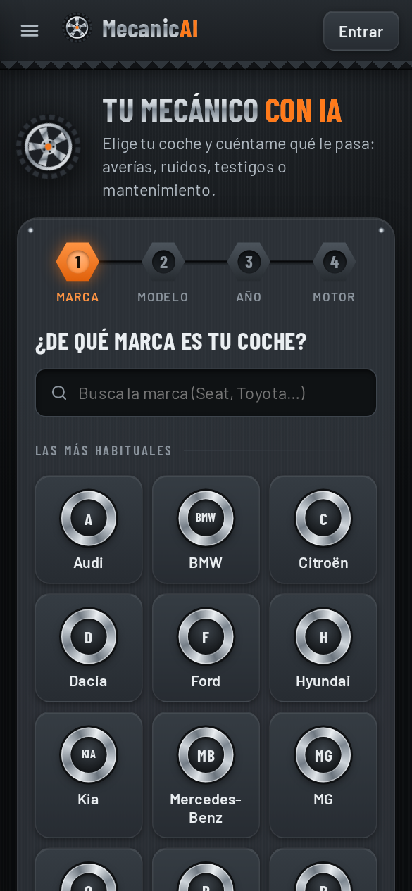
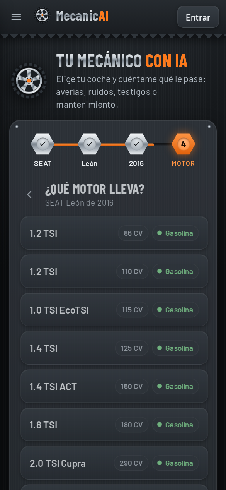
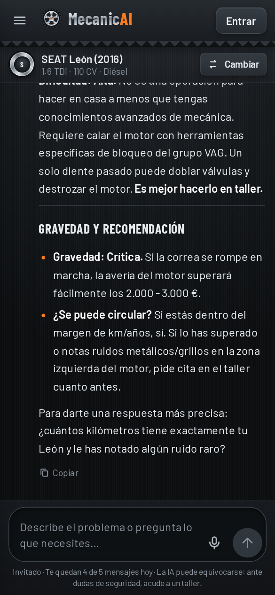
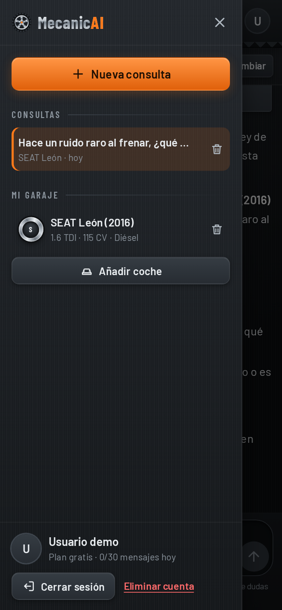
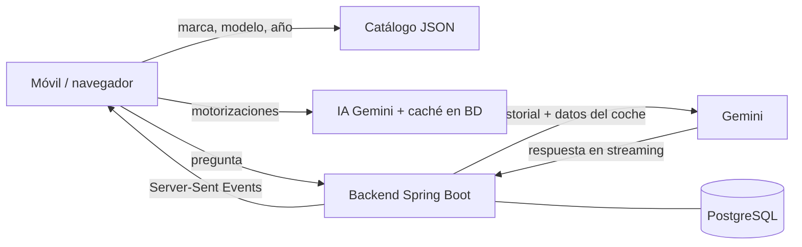

# MecanicAI · Tu mecánico con IA

SaaS web (pensado para el móvil) en el que el usuario elige su coche —**marca → modelo → año → motorización**— y
después pregunta lo que necesite a un mecánico de inteligencia artificial que responde teniendo en cuenta ese coche
concreto.

| Elige la marca | Motorización | Chat con la IA | Historial y garaje |
| :---: | :---: | :---: | :---: |
|  |  |  |  |

## Funcionalidades

- **Asistente del coche** en 4 pasos con buscador. Catálogo de ~57 marcas y ~900 modelos del mercado español con sus
  años de venta. Las **motorizaciones las sugiere la IA** para ese modelo y año y se guardan en caché (cada combinación
  se consulta una sola vez). Si el coche no está, se puede escribir a mano o elegir "no sé el motor".
- **Chat con IA en tiempo real** (streaming, como ChatGPT/Gemini): respuestas en Markdown, botón de detener, reintentar
  si falla, copiar la respuesta y sugerencias rápidas. El "mecánico" conoce el coche, avisa de los riesgos de seguridad y
  dice cuándo ir al taller.
- **Informe médico** (menú lateral): eliges el coche e indicas sus kilómetros y hace cuántos km o cuánto tiempo se
  le cambió cada cosa (aceite, filtros, bujías, correa o cadena de distribución, correa de accesorios, frenos,
  neumáticos, refrigerante, batería, amortiguadores…). Devuelve un informe por colores: **rojo** (toca cambiarlo),
  **ámbar** (pronto), **verde** (al día) y **gris** (sin datos), con un botón para preguntar al mecánico IA por lo
  pendiente. La IA indica si ese motor lleva correa (o correa bañada en aceite) o cadena y sus intervalos de
  mantenimiento; se guarda en caché (`maintenance_cache`) y, si la IA no responde, se usan intervalos habituales.
  Lo poco importante (filtro de habitáculo y escobillas) se revisa siempre cada 4 años.
  **Con cuenta de Google** se guarda el último informe de cada coche (`health_report`) y se pueden hacer 5 informes a
  la semana; **como invitado** no se guarda nada y solo se pueden hacer 2 (se le invita a iniciar sesión).
  Configurable con `FREE_WEEKLY_REPORTS` y `GUEST_WEEKLY_REPORTS`.
- **Portada** con dos opciones: **Iniciar con Google** o **Modo Invitado** (pocos mensajes al día y nada guardado en
  el servidor). Al iniciar sesión, la consulta del invitado y su coche se guardan automáticamente en la cuenta.
- **Historial de consultas y garaje** (varios coches por usuario), borrar consultas/coches y **eliminar la cuenta** (RGPD).
- **Límites**: invitado 5 mensajes/día y 2 informes médicos/semana; cuenta gratuita 20 mensajes/día y 5
  informes/semana (configurable). Plan **PRO** preparado para el futuro (más mensajes y otro modelo de IA).
- **Dictado por voz** (botón de micrófono, Web Speech API del navegador, sin coste).
- **Instalable como app** (PWA): pantalla completa y vertical, icono propio.
- Diseño mecánico: grafito y acero cepillado, logotipo circular con la M, llanta como indicador de carga, tapacubos
  por marca, pasos en forma de tuerca y franja de dibujo de neumático.
- **Páginas legales**: política de privacidad (`/privacidad`), términos y aviso legal (`/terminos`) y política de
  cookies (`/cookies`), enlazadas desde la portada y el menú. Son HTML estático en `frontend/public/*.html`:
  actualízalas si cambia qué datos se guardan o con quién se comparten.

## Tecnologías

| Parte | Tecnología |
| --- | --- |
| Frontend | React 19 + TypeScript + Vite 8, React Router 8, react-markdown, vite-plugin-pwa |
| Backend | Java 25 + Spring Boot 4.1 + Maven (Spring Security OAuth2, Spring Data JPA, Flyway, validación) |
| Base de datos | PostgreSQL 17 |
| IA | Google Gemini con el SDK oficial `com.google.genai` (detrás de una interfaz `AiClient` para poder cambiar de proveedor) |

```
MecanicAI/
├── backend/            API REST (Spring Boot)
│   └── src/main/
│       ├── java/com/mecanicai/   auth, user, vehicle, catalog, chat, ai, usage, config
│       └── resources/            application.yml, catalog/vehicles.json, db/migration (Flyway)
├── frontend/           Web (React + Vite)
│   └── src/            api, components, context, features (wizard, chat), pages, styles
├── compose.yaml        Despliegue con contenedores (PostgreSQL + backend + nginx)
└── docs/
    ├── capturas/
    └── marca/          Logotipo en PNG (120 px para la consola de Google y 512 px)
```

**Logotipo**: el original es `frontend/public/logo.svg`. Si lo cambias, regenera el favicon y los iconos de la app con
`cd frontend && npm run generate-pwa-assets`.

## Puesta en marcha en local

El orden siempre es el mismo: **1) base de datos → 2) backend → 3) frontend**. El backend necesita la base de datos
para arrancar (crea las tablas al iniciar) y la web necesita el backend para funcionar.

### 1. Requisitos

- **JDK 25** (Fedora solo trae el JRE; para compilar hace falta el JDK):
  ```bash
  sudo dnf install java-25-openjdk-devel
  ```
- **Node.js 22+** y **podman** (ya los tienes).

### 2. Base de datos (primero)

```bash
podman run -d --name mecanicai-db -p 5432:5432 \
  -e POSTGRES_DB=mecanicai -e POSTGRES_USER=mecanicai -e POSTGRES_PASSWORD=mecanicai \
  -v mecanicai-data:/var/lib/postgresql/data docker.io/library/postgres:17-alpine
```

Las siguientes veces basta con `podman start mecanicai-db`. Las tablas las crea Flyway al arrancar el backend.

### 3. Backend (segundo)

```bash
cd backend
cp .env.example .env        # y pon tu GEMINI_API_KEY (ver más abajo)
./mvnw spring-boot:run -Dspring-boot.run.profiles=dev
```

Sin `GEMINI_API_KEY`, el perfil `dev` arranca la IA en **modo demo** (respuestas de ejemplo) para poder trabajar en la
interfaz sin clave. Sin credenciales de Google, la portada solo ofrece el **Modo Invitado**.

### 4. Frontend (tercero)

```bash
cd frontend
npm install
npm run dev
```

Abre <http://localhost:5173>. Vite reenvía `/api`, `/oauth2` y `/login/oauth2` al backend (puerto 8080), así el
navegador ve un único dominio y las cookies de sesión funcionan.

**Probar en tu móvil** (misma wifi): `npm run dev -- --host` y abre `http://IP-DE-TU-PC:5173`. El micrófono y la
instalación como app requieren HTTPS fuera de `localhost`, así que para probarlos en el móvil hay que desplegarla con
HTTPS.

## Conseguir la API key de Gemini (gratis)

1. Entra en <https://aistudio.google.com/apikey> con tu cuenta de Google y pulsa **Create API key**.
2. Ponla en `backend/.env` como `GEMINI_API_KEY=...` y reinicia el backend.

Modelos por defecto, **en orden de preferencia**: si uno está saturado (algo habitual en la capa gratuita), la app
prueba automáticamente el siguiente. Se cambian con variables de entorno (ver `application.yml`):

| Uso | Modelos | Variable |
| --- | --- | --- |
| Chat plan gratuito (razonamiento mínimo) | `gemini-3.5-flash-lite`, `gemini-3.5-flash`, `gemini-3-flash-preview`, `gemini-3.1-flash-lite`, `gemini-3.8-flash`, `gemini-3.7-flash`, `gemini-3.6-flash` | `GEMINI_CHAT_MODELS` |
| Sugerir motorizaciones | `gemini-3.5-flash`, `gemini-3-flash-preview`, `gemini-3.5-flash-lite`, `gemini-3.1-flash-lite`, `gemini-3.8-flash`, `gemini-3.7-flash`, `gemini-3.6-flash` | `GEMINI_ENGINES_MODELS` |
| Plan PRO (futuro) | `gemini-3.8-flash`, `gemini-3.7-flash`, `gemini-3.6-flash` | `GEMINI_PRO_MODELS` |

**A tener en cuenta con la capa gratuita de Gemini:**

- Los límites (peticiones por minuto y por día) son **por proyecto de Google y modelo, compartidos por todos tus
  usuarios**. En octubre de 2026 eran de unas **20 peticiones al día por cada modelo Flash** y unas **500 para
  `gemini-3.5-flash-lite`**; consulta los tuyos en <https://aistudio.google.com/rate-limit>. Si se superan en todos los
  modelos, la app muestra "La IA está saturada, inténtalo en unos segundos" y no descuenta el mensaje al usuario. Si
  se te queda corto, activa la facturación del proyecto (los modelos Flash cuestan céntimos por conversación).
- La disponibilidad de cada modelo cambia a lo largo del día (errores 503 "high demand" o 429 sin cuota). Cuando un
  modelo falla, la app lo deja **2 minutos al final de la lista** y responde con el siguiente, sin reintentos que hagan
  esperar al usuario. Medido el 1 de octubre de 2026 con la misma pregunta: con el orden anterior (`gemini-3.6-flash`
  primero, sin cuota, y `3.7`/`3.8` saturados) la respuesta empezaba a los 16 s; con `gemini-3.5-flash-lite` primero y
  razonamiento mínimo, en 1 s (4 s en total).
- Uso de los datos: fuera de Europa, en la capa gratuita Google puede usar las consultas para mejorar sus productos.
  Pero **si estás en el Espacio Económico Europeo, Suiza o Reino Unido, se aplican las condiciones de la capa de pago
  también a la gratuita** (Google no las usa para eso). Aun así, la política de privacidad debe decir que las preguntas
  se envían a Google Gemini para generar la respuesta.
- Las condiciones de la API de Gemini exigen tener **18 años** y que la app no esté dirigida a menores de 18.
  Fuente: <https://ai.google.dev/gemini-api/terms>.

## Configurar el login con Google

Todo está en <https://console.cloud.google.com/auth> (**Google Auth Platform**; antes se llamaba "Pantalla de
consentimiento de OAuth"). Elige arriba el proyecto donde creaste el cliente.

1. **Marca (Branding)**:
   - Nombre "MecanicAI", correo de asistencia y correo de contacto del desarrollador.
   - Logotipo: `docs/marca/logo-120.png`.
   - Dominio de la aplicación: página principal `https://mecanicai.org`, política de privacidad
     `https://mecanicai.org/privacidad` y condiciones del servicio `https://mecanicai.org/terminos`.
   - Dominios autorizados: `mecanicai.org`.
2. **Público (Audience)**: tipo *Externo*. Mientras esté en **Prueba**, solo entran las cuentas añadidas como usuarios
   de prueba; pulsa **Publicar aplicación** para que pueda entrar **cualquier cuenta de Google**. Como la app solo pide
   `openid`, `email` y `profile` (ámbitos no sensibles), no hace falta la verificación de Google ni aparece el aviso de
   "app no verificada".
3. **Acceso a datos (Data access)**: solo `openid`, `.../auth/userinfo.email` y `.../auth/userinfo.profile`.
4. **Clientes → tu cliente web**:
   - Orígenes de JavaScript autorizados: `http://localhost:5173` y `https://mecanicai.org`.
   - URI de redirección autorizados (exactos, sin barra final): `http://localhost:5173/login/oauth2/code/google` y
     `https://mecanicai.org/login/oauth2/code/google`.
5. Copia el ID y el secreto en `backend/.env` (local) o en el `.env` del servidor (`GOOGLE_CLIENT_ID`,
   `GOOGLE_CLIENT_SECRET`) y reinicia el backend: el botón "Iniciar con Google" aparece solo.

Los cambios en la consola pueden tardar unos minutos en aplicarse. Si al volver de Google aparece
`redirect_uri_mismatch`, la URI del paso 4 no coincide exactamente con la del navegador.

**Verificación de la marca**: al subir un logotipo, Google revisa la marca antes de mostrarlo (gratis, unos días).
Para pedirla, la web ya debe estar publicada en `https://mecanicai.org` (la portada enlaza a la política de privacidad)
y el dominio verificado en [Search Console](https://search.google.com/search-console) (registro TXT en el DNS). Mientras
tanto, cualquier cuenta de Google puede iniciar sesión igualmente si la app está publicada.

## Cómo funciona



- **Sesión**: tras el login de Google, el backend crea una cookie `HttpOnly` con un JWT propio (30 días, se renueva
  sola). Protección CSRF: cookie `SameSite=Lax` + cabecera obligatoria `X-MecanicAI` en las peticiones que modifican
  datos.
- **Invitados**: la consulta se guarda solo en el navegador (localStorage). El límite va por cookie anónima (5 al día)
  y por IP (20 al día entre todos los invitados de una misma conexión): otro navegador o una ventana de incógnito es
  un invitado nuevo, pero desde la misma conexión no pasa de 20.
- **Límites**: contadores atómicos en PostgreSQL (`usage_counter`): por día para los mensajes y por semana (con el
  lunes como fecha) para los informes médicos. Si la IA falla, el mensaje no se descuenta.
- **Prompt del mecánico**: `backend/src/main/java/com/mecanicai/chat/PromptBuilder.java`.
- **Catálogo**: `backend/src/main/resources/catalog/vehicles.json` (formato `"Modelo": "1991-2004,2024-"`); se puede
  ampliar sin tocar código.

### API

| Método | Ruta | Descripción |
| --- | --- | --- |
| GET | `/api/auth/me` | Usuario (o invitado), uso de hoy y opciones disponibles |
| POST | `/api/auth/logout` · DELETE `/api/auth/account` | Cerrar sesión · borrar cuenta y datos |
| GET | `/api/catalog/brands` · `/api/catalog/brands/{marca}/models` | Catálogo |
| GET | `/api/catalog/engines?brand=&model=&year=` | Motorizaciones sugeridas por la IA |
| GET/POST/DELETE | `/api/vehicles` | Garaje del usuario |
| GET/POST/DELETE | `/api/conversations` | Historial de consultas |
| POST | `/api/conversations/{id}/messages` · `/retry` | Pregunta / reintento (respuesta en streaming SSE) |
| POST | `/api/conversations/import` | Guarda en la cuenta la consulta hecha como invitado |
| POST | `/api/guest/chat` | Chat de invitado (streaming SSE) |

## Tests

```bash
cd backend && ./mvnw test          # catálogo, prompt, respuestas de la IA, cambio de modelo, seguridad
cd frontend && npm run lint && npm run build
```

## Despliegue en internet, paso a paso

```
Usuario ──HTTPS──▶ Caddy ──▶ nginx (web + /api) ──▶ backend Spring Boot ──▶ PostgreSQL
                  (certificado                              └──────────────▶ Gemini
                   automático)
```

Todo va en contenedores definidos en `compose.yaml`, y compose se encarga del orden de arranque.

### Qué necesitas

- **Un servidor Linux** con IP pública y al menos 2 GB de RAM (mejor 4 GB: Java, PostgreSQL y la compilación de las
  imágenes), en una región de la Unión Europea (así lo dice la política de privacidad). Opciones en octubre de 2026:
  gratis, una máquina Ampere A1 de la capa *Always Free* de Oracle Cloud; de pago, un VPS de OVHcloud, Contabo o
  Hetzner (unos 5-7 €/mes más IVA; los precios han subido varias veces en 2026, compruébalos al contratar).
- **Un dominio** (unos 10 €/año). Google solo permite el login en producción con un dominio real y HTTPS.
- Tu **API key de Gemini** y, para el login, las credenciales OAuth de Google.

### Paso 1 · Preparar el servidor

Crea el servidor con Ubuntu 24.04 y abre los puertos 22, 80 y 443 en el firewall del proveedor.

En **Oracle Cloud**: crea la instancia en tu región de origen con la forma `VM.Standard.A1.Flex` (Arm), imagen
*Canonical Ubuntu 24.04* y 2 OCPU / 8 GB. Oracle puede recuperar las máquinas gratuitas que pasan 7 días casi sin uso
(menos del 20 % de CPU, red y memoria): con 8 GB la app supera ese 20 % de memoria; pasar la cuenta a *Pay As You Go*
(sigue siendo gratis dentro de los límites; pon una alerta de presupuesto de 1 €) también ayuda. Los puertos 80 y 443
se abren en *Networking → Virtual Cloud Networks → tu VCN → Security Lists → Add Ingress Rules* (origen `0.0.0.0/0`).

Después:

```bash
ssh root@IP-DEL-SERVIDOR
curl -fsSL https://get.docker.com | sh      # instala Docker y Docker Compose
```

### Paso 2 · Apuntar el dominio al servidor

En el panel de tu dominio crea dos registros DNS **tipo A** con la IP del servidor: `@` (es decir, `mecanicai.org`) y
`www` (Caddy redirige `www.mecanicai.org` → `mecanicai.org`). **En Cloudflare**, pon el estado del proxy en
**Solo DNS** (nube gris): con la nube naranja, Caddy no puede sacar el certificado HTTPS de forma sencilla y el
backend vería las IPs de Cloudflare en lugar de las de los visitantes. Borra los registros A/AAAA o "parking" que trajera el
dominio y **no crees registros AAAA** (IPv6) salvo que configures IPv6 en Docker: sin eso, las visitas por IPv6
llegarían al backend todas con la misma IP interna y compartirían el límite diario de invitados.

Comprueba con `dig +short mecanicai.org` (o `ping mecanicai.org`) que ya devuelve la IP del servidor **antes del
paso 5**: Caddy lo necesita para conseguir el certificado HTTPS.

### Paso 3 · Subir el código

Lo más cómodo es un repositorio privado de GitHub (el `.gitignore` ya excluye los `.env` con las claves):

```bash
git clone https://github.com/TU-USUARIO/mecanicai.git /opt/mecanicai && cd /opt/mecanicai
```

O cópialo desde tu PC:
`rsync -av --exclude node_modules --exclude target --exclude .env MecanicAI/ root@IP-DEL-SERVIDOR:/opt/mecanicai/`

### Paso 4 · Configurar las claves

```bash
cp .env.example .env
nano .env
```

Rellena `DOMAIN` (`mecanicai.org`, sin `https://` ni `www`), `GEMINI_API_KEY`, `JWT_SECRET` (`openssl rand -base64 48`), `DB_PASSWORD`
(`openssl rand -base64 24`) y, para el login, `GOOGLE_CLIENT_ID` y `GOOGLE_CLIENT_SECRET`.

### Paso 5 · Arrancar

```bash
docker compose up -d --build
```

La primera vez tarda unos minutos (compila el backend y el frontend). Compose arranca los servicios en este orden:

1. **db**: PostgreSQL; espera a que esté lista para aceptar conexiones.
2. **backend**: Spring Boot; al arrancar crea o actualiza las tablas automáticamente (Flyway).
3. **frontend**: nginx con la web; reenvía `/api` al backend.
4. **caddy**: consigue el certificado HTTPS y publica la web en los puertos 80 y 443.

### Paso 6 · Comprobar

```bash
docker compose ps                 # los 4 servicios en marcha ("Up")
docker compose logs -f backend    # debe aparecer "Started MecanicAiApplication"
docker compose logs caddy         # debe aparecer "certificate obtained successfully"
```

Abre `https://mecanicai.org` en el móvil, entra como invitado, elige un coche y haz una pregunta. Después comprueba
que el backend ve la **IP real** de cada visitante (el límite de invitados va por IP):

```bash
docker compose exec db psql -U mecanicai -c "SELECT subject, count FROM usage_counter WHERE subject LIKE 'ip:%'"
```

Debe salir la IP pública de tu conexión (la de <https://ifconfig.me>), no una del tipo `172.x.x.x` o `10.x.x.x`.

### Paso 7 · Login con Google en producción

En la consola de Google (ver [Configurar el login con Google](#configurar-el-login-con-google)) añade el origen
`https://mecanicai.org` y la redirección `https://mecanicai.org/login/oauth2/code/google`, y **publica la app**
(Público → Publicar aplicación) para que pueda entrar cualquier cuenta de Google.

### Mantenimiento

| Tarea | Comando |
| --- | --- |
| Actualizar tras cambiar el código | `git pull && docker compose up -d --build` |
| Ver errores | `docker compose logs -f backend` |
| Copia de seguridad de la BD | `docker compose exec -T db pg_dump -U mecanicai mecanicai > copia-$(date +%F).sql` |
| Restaurar una copia | `docker compose exec -T db psql -U mecanicai mecanicai < copia.sql` |
| Parar todo (los datos se conservan) | `docker compose down` (con `down -v` se **borrarían** los datos) |

**Copia diaria automática** (guarda 14 días): `crontab -e` y añade esta línea:

```
0 4 * * * cd /opt/mecanicai && docker compose exec -T db pg_dump -U mecanicai mecanicai | gzip > /root/copia-mecanicai-$(date +\%F).sql.gz && find /root -name 'copia-mecanicai-*' -mtime +14 -delete
```

Mejor aún si además la copias fuera del servidor de vez en cuando (`scp root@IP:/root/copia-mecanicai-* .`).
`DB_PASSWORD` solo se aplica al crear la base de datos la primera vez: si la cambias después en `.env`, el backend
no podrá conectar.

**¿Podman en lugar de Docker?** Funciona con `podman-compose` (probado con la versión 1.6), pero en el servidor es
más sencillo Docker. Si usas podman **sin root**, el contenedor de Caddy no ve la IP real de los visitantes (todos
llegan con la misma IP interna y compartirían el límite de 20 mensajes de invitado al día): ejecútalo como root
(`sudo podman-compose ...`) y haz la comprobación de IP del paso 6. Al actualizar usa
`podman-compose up -d --build --force-recreate`, porque podman-compose no recrea solo los contenedores que cambian.

## Próximos pasos (hoja de ruta)

- **Suscripción PRO con Stripe**: el modelo de datos ya tiene `plan` (FREE/PRO) y cada plan su modelo y su límite en
  `app.plans`. Hoy se puede probar a mano: `UPDATE app_user SET plan = 'PRO' WHERE email = '...';`
- **IA más potente para PRO (p. ej. GPT)**: implementar `AiClient` con el SDK de OpenAI y elegir el proveedor según el
  plan; el resto de la app no cambia.
- La API `generateContent` de Gemini que se usa está soportada pero Google recomienda su nueva *Interactions API* para
  proyectos nuevos; migrar solo afecta a `GeminiAiClient`.
- Fotos en el chat (testigos del cuadro, piezas): Gemini ya entiende imágenes.
